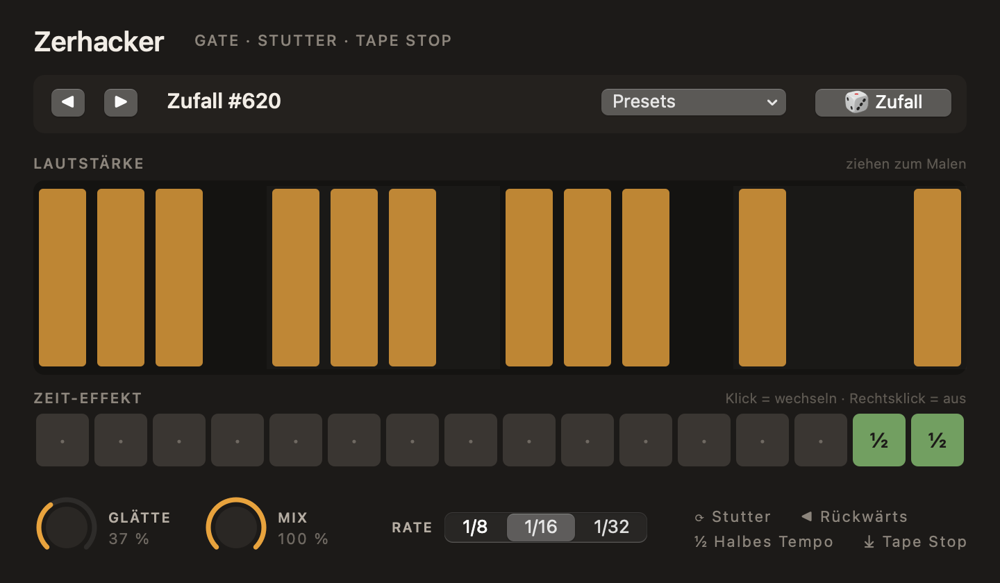

# Zerhacker

Zerhacker is a VST3 effect for digital audio workstations such as FL Studio, Ableton Live or Logic Pro. It locks to the tempo of your song and manipulates audio in time and volume, turning a static loop into rhythmic gates, stutters, reversed fills, half-time passages and tape stops. It works on anything from a single vocal to a full beat on the master bus.

The project is still a work in progress.



## Features

**Volume lane.** One bar is divided into sixteen steps, and the volume of each step can simply be drawn with the mouse. This makes it easy to create anything from hard trance gates to soft sidechain-style pumping.

**Time lane.** Every step can be assigned a time effect with a single click:

- **Stutter** repeats a short slice of audio, producing classic rolls and fills
- **Reverse** plays the preceding audio backwards
- **Half speed** slows the audio down to half time
- **Tape stop** gradually brings the playback to a halt, with the length defined by the number of steps

**Rate and feel.** The grid can run in eighth, sixteenth or thirty-second notes. A smoothing control softens the transitions between steps, and a mix control blends the processed signal with the original.

**Presets and randomisation.** Thirty-six presets range from simple gates and pumping effects to stutter fills, tape stops and glitch patterns. A random button builds new patterns from repeating rhythmic motifs and places time effects where they tend to work best, usually towards the end of a bar.

## How it's made

- Written in C++ and Objective-C++ on top of the Steinberg VST3 SDK
- Synchronised to the host's tempo and playback position, with an internal clock when the transport is stopped
- All time effects read from a continuously recorded ring buffer, so they introduce no latency
- Short crossfades and gain smoothing prevent clicks whenever an effect starts or ends
- The user interface is drawn entirely with Core Graphics, without a UI framework
- Verified with the official Steinberg VST3 validator and a custom offline test suite that runs on GitHub Actions

## Building

You will need a Mac with Xcode or the Command Line Tools, as well as CMake.

```bash
./scripts/build.sh --install
```

The script builds the plugin, runs the tests and installs it to `~/Library/Audio/Plug-Ins/VST3`, after which it can be loaded as an effect in your DAW.
